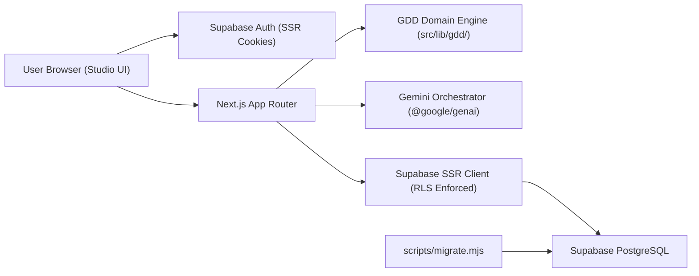

# AgentGDD — Architecture

## Overview
**AgentGDD** is an AI-powered Game Design Document (GDD) studio built on Next.js App Router, Supabase PostgreSQL + Auth, and Google Gemini (`@google/genai`). It transforms freeform or guided game concepts into structured, production-ready 12–15 section Project Bibles based on [Prompt-Agente-GDD-IA](../Prompt-Agente-GDD-IA).

## System Architecture

## Directory Structure

| Path | Responsibility |
| :--- | :--- |
| `.agents/skills/agentgdd-standards/` | Mandatory engineering skill enforcing documentation, migrations, Playwright tests, and Git discipline. |
| `supabase/migrations/` | Sequential SQL migrations executed directly via `scripts/migrate.mjs`. |
| `src/types/` | Strict TypeScript contracts for GDD briefs, sections, entities, audits, and API payloads. |
| `src/lib/gdd/` | Pure domain logic: prompt builder, conflict detector, Markdown parser, 12+ point quality auditor, HEX color utils, and `.md`/JSON/CSV exporters. |
| `src/lib/ai/` | Server-side `@google/genai` client and multi-stage section generation/refinement/moodboard orchestrator. |
| `src/lib/supabase/` | Browser, server SSR, and admin Supabase helpers + session auth guards. |
| `src/app/api/` | Authenticated Route Handlers for projects, sections, entities, generation streaming, audits, versioning, comments, and exports. |
| `src/components/` | Accessible, dark/light-aware Studio UI components (Wizard, Section Navigator, Markdown/Mermaid Viewer, HEX Palette Swatches, Entity Tables, Audit Panel). |
| `tests/unit/` | Playwright pure unit tests (`--project=unit`). |
| `tests/api/` | Playwright API tests (`--project=api`). |
| `tests/e2e/` | Playwright Chromium end-to-end tests (`--project=e2e`). |
| `docs/` | Living documentation (`ARCHITECTURE.md`, `DATABASE.md`, `API.md`, `CHANGELOG.md`, `FEATURES/`). |
